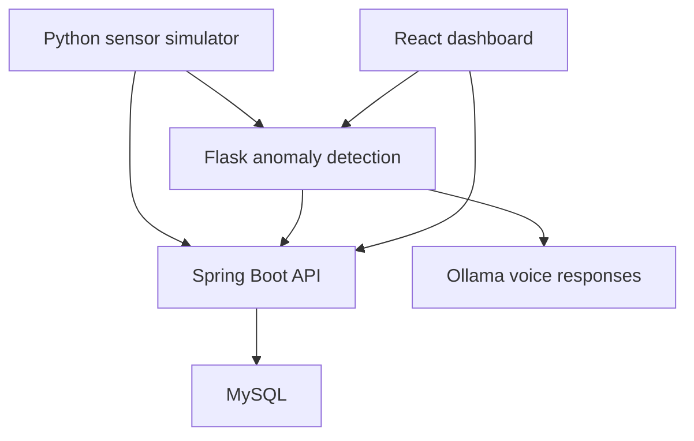

# Smart Motor — Simulation-Based Agriculture Monitoring

A student prototype for exploring agricultural pump monitoring, anomaly detection, and a Tamil/English voice assistant.

## What is implemented

- A Python simulator generates current, voltage, temperature, flow, and water-level readings.
- A Spring Boot REST API stores readings in MySQL and applies rule-based alerts.
- Dry-run and overheat conditions change the software motor state to `PROTECTION_STOP`; blockage conditions raise a warning.
- A React dashboard displays readings, alerts, history, and motor status.
- A Flask service combines Isolation Forest predictions with engineering thresholds.
- Ollama supplies local language-model responses for the bilingual voice assistant.

## Architecture

## Demonstration scenarios

| Scenario | Expected software behavior |
| --- | --- |
| Normal readings | Motor continues running |
| Low water level and low flow | High-severity dry-run alert and protection-stop state |
| High temperature | High-severity overheat alert and protection-stop state |
| High current with reduced flow | Blockage warning; no automatic software shutdown |
| Repeated same-type alert | Duplicate alert suppressed during cooldown |

## Technology

Java, Spring Boot, MySQL, React, Vite, Python, Flask, scikit-learn, Docker Compose, and Ollama.

## Current boundaries

This is a simulation-based learning prototype, not a deployed motor safety system. No ESP32 firmware, physical sensor integration, or relay-control implementation is included. The anomaly model uses a small synthetic training set; it has not been validated for production fault prediction. Authentication and restricted CORS remain future work.

The source repository is currently private. This page is a public project overview, not a source-code release or live demo.

[Developer portfolio](https://placement-portfolio-ashy.vercel.app/) · [LinkedIn](https://www.linkedin.com/in/dhineshvdev/)
